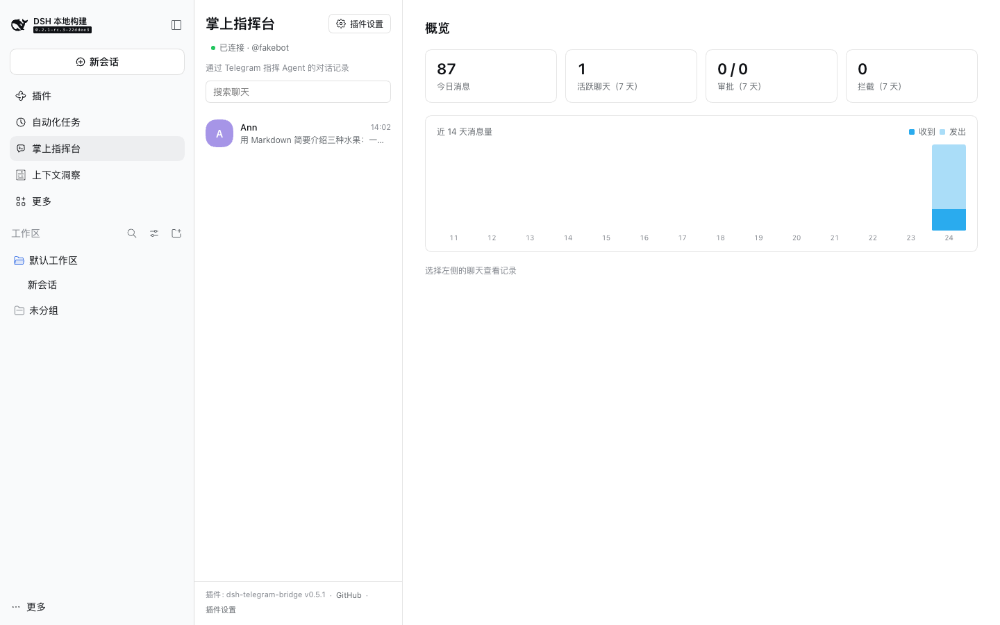
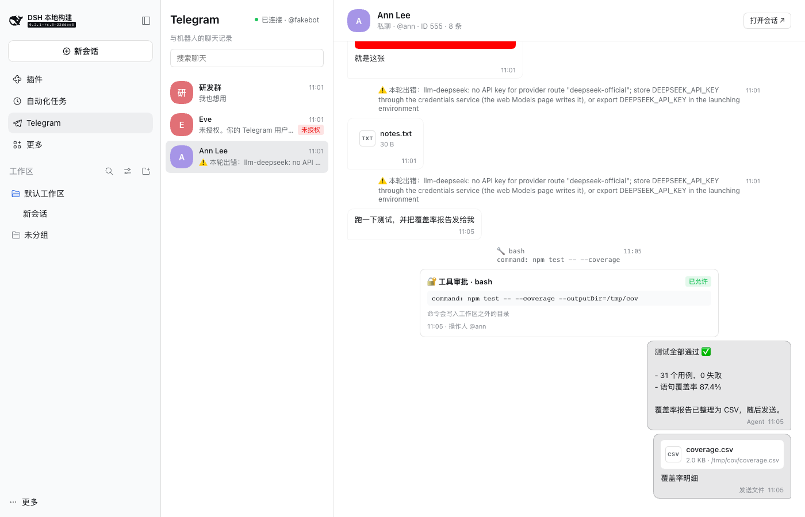

# Switchboard (dsh-switchboard)

English | [中文](README.zh.md)


Command DeepSeek Harness Agents from your phone through Telegram and Feishu (Lark) bots: send the Agent text, photos, files, and voice notes, watch replies arrive as they are written, answer tool approvals and the Agent's questions, follow long tasks for completion notices, and browse every chat in the Web UI, where any Session can be linked to a chat.

The bots are other clients of the Web host. They create and prompt Sessions through `ctx.sessionController`, the same path the Web UI uses, so chat Sessions appear in the Web sidebar and Web Sessions can be taken over or followed. Sessions a bot creates go into the Web Workspace for their working directory (created on first use).



## Lines

A **line** is one bot on one chat platform plus the people allowed to use it. Configure as many as you need, for example Telegram for yourself and Feishu for your team; each line has its own credentials, allowed users and chats, and default working directory. One Session can be linked to chats on several lines at once, and replies, approvals, and questions go to each of them. Chats are keyed `line:chat id` (for example `feishu:oc_xxx`); the original Telegram line (`telegram`) keeps bare ids, so bindings and history from earlier releases carry over. Supported: **Telegram** and **Feishu / Lark**.

## Quick start

1. Install into a Web profile: **Plugins → Add plugin** with `github:heavenJiang/dsh-switchboard`, or `dsh plugin --profile web add github:heavenJiang/dsh-switchboard`.
2. Open **Plugins → Installed → Switchboard** (or **Plugin settings** in the sidebar panel), add a line under **Lines**, fill in its credentials and **Allowed users** (send `/whoami` to the bot for your id), set the **Default working directory**, and **Save**. Changes apply immediately.

**Telegram line**: create a bot with [@BotFather](https://t.me/BotFather) (`/newbot`), then **+ Telegram line** and paste the token. Allowed users are Telegram ids or `@usernames`.

**Feishu line**: Feishu delivers events over the Open Platform's persistent connection, so no public URL is needed.

**By QR (recommended)**: **+ Feishu line** → **Create a Feishu app by QR**, scan with the Feishu app (or **Open in browser** on this computer), and confirm. The bot, permissions, the `im.message.receive_v1` event, and the `card.action.trigger` callback are filled in; the Host stores the App Secret in the credentials store (it never reaches the browser), the scanner is added to the allowed users, and the line is saved and connects. For an existing app, **Complete permissions** adds what is missing the same way.

**By hand**:
1. On the [Feishu Open Platform](https://open.feishu.cn/app) (or [Lark](https://open.larksuite.com/app)) create a self-built app and add the **Bot** capability.
2. Grant `im:message.p2p_msg:readonly`, `im:message.group_at_msg:readonly`, `im:message:send_as_bot`, and `im:resource`; optionally `contact:user.base:readonly` (names) and `im:chat:readonly` (group names).
3. Add **+ Feishu line** with the **App ID** (`cli_…`) and **App Secret** and save: Feishu lets you pick the persistent connection only while a client is connected.
4. Under **Events and callbacks**, choose **Receive events through persistent connection** and add the event `im.message.receive_v1`; do the same for callbacks and add `card.action.trigger` (buttons need it).
5. Publish a version, message the bot `/whoami`, and add the open_id it replies with (`ou_…`, per app; user_id and union_id also match) to the line's allowed users.

Feishu has no typing indicator or command menu; everything else matches Telegram. Replies, drafts, tool activity, and messages with buttons are interactive cards updated in place; notices are text messages.

## In the chat

| Command | Effect |
| --- | --- |
| text, photo, file, voice | Goes to the current Session; one is started in the default directory if needed |
| `/menu` | Buttons for common actions (new session, sessions, model, mode, stop, compact, status, help); the easiest way in Feishu |
| `/new [dir]` | New Session; without a directory, pick the default or a recent one |
| `/cwd <dir>` | Working directory for this chat's new Sessions |
| `/sessions` | Recent Sessions with titles, as buttons that switch |
| `/use <n\|sessionId>` | Switch to an existing Session (Web ones too) |
| `/watch [n\|sessionId]` | Follow a Session's completions and approvals; no argument lists them |
| `/unwatch <n\|sessionId\|all>` | Stop following |
| `/stop` | Stop current work |
| `/steer <text>` | Steer the running turn |
| `/queue`, `/cancel <n\|all>` | Show or drop queued messages |
| `/model [name]` | Show or switch the Session's model (buttons, fuzzy match; the Web default is untouched) |
| `/mode [mode]` | Show or switch the Session's permission mode |
| `/get <path>` | Fetch a file or list a directory inside the working directory (symlinks cannot escape it) |
| `/status` | Session, model, directory, run state, and line |
| `/whoami` | Your user and chat id (anyone) |
| Harness commands | `/compact`, `/plan`, `/goal`, `/permission`, `/export`, … run on the Host exactly as in the Web composer; `/help` lists them |
| other `/xxx` | Not a command: sent to the Agent as text |

- **Rendering**: Markdown becomes Telegram HTML (with a plain-text fallback) or a Feishu card's Markdown, split safely.
- **One progress message**: while a turn runs, a single "⏳ Working · time · N tool calls" message shows the latest tool calls and the reply being written, with a **⏹ Stop** button, and is replaced by the reply; a stop or failure is told there too.
- **Acknowledged at once**: your message gets 👀 (Feishu: OnIt) while it is worked on, cleared when done; a message sent during a running turn gets a "Queued" notice with **Steer now** and **Cancel**.
- **Buttons under the reply**: **Continue**, **Retry**, **Show changes** (the turn's changes as a diff file, new files included), and **New session**; they move to the next reply.
- **Turn summaries**: duration, tool calls, and changed files after long turns (configurable).
- **Context and long content**: replying to (quoting) a message sends its text along. Replies over **Long reply as a file** (6000 characters) arrive as a preview plus a Markdown file; Feishu cards fold code blocks over 15 lines.
- **Approvals and questions**: **Allow once / Reject** buttons, with a diff for file edits; the Agent's questions get option buttons, and plain text while a question waits becomes the answer. Unanswered ones go to the Web UI after the timeout.
- **Media**: photos and files are staged through `ctx.fileUploads`; images reach the model as images. Voice notes are transcribed by the Harness speech service via ffmpeg. Files the Agent presents are sent back.
- **Nothing lost**: replies, turn notices, and presented files that cannot be sent (line down, or a send that certainly failed) wait in an outbox and go out, marked late, once the line is back; sends with an unknown outcome are not repeated. After a plugin restart, the final reply of each turn that ended meanwhile is sent (up to 3 per Session). A line down longer than **Outage alert after** (5 min) is reported to the **Line outage alert chats** through another line.
- **Groups**: by default only commands, @mentions, and replies to the bot are answered. Authorize users or whole chats per line.
- **Security**: only a line's allowed users (or members of its allowed chats) can use its bot. Secrets live in the Harness credentials store (`TELEGRAM_BOT_TOKEN`, `FEISHU_APP_SECRET`, or environment variables of those names), never in the profile file or the browser.

## In the Web UI

- **Switchboard console** (sidebar), four tabs: **Chats** (every line's chats, an overview with a 14-day chart, full threads with **Open Session**); **Lines** (one-line summaries that open for editing, Feishu added by QR); **Members** (people waiting for approval, allowed with one click and told so, and everyone allowed per line); **Settings** (common options first, the rest under **Advanced**).
- **Switchboard tab in every Session**: linked chats on any line, bind or follow another chat, send as the bot, and the Session's chat activity.
- **`/switchboard` in the composer**: `bind`, `watch`, `unbind`, and `send` for the open Session.
- **Channel note**: Sessions bound to a chat get a short note asking for phone-friendly replies.



## Models

A `/model` choice for the Session > the plugin page's **Bot default model** for Sessions a bot creates > the Web default. Neither changes the Web default.

## Configuration

See the full tables in [README.zh.md](README.zh.md#配置项). `lines` holds the lines; while it is empty, the Telegram fields of earlier releases (`botTokenRef`, `allowedUsers`, …) run as the `telegram` line, and the plugin page writes them to `lines` on its next save. `pollTimeoutSec` and `stateFile` live in the profile's `cordis.patch.yml`. Set `HTTPS_PROXY` before launching `dsh` if the platforms are not directly reachable. Migrating from `dsh-telegram-bridge`: see [docs/PUBLISHING.md](docs/PUBLISHING.md).

## Adding a channel

Implement the `Channel` interface in `src/channels/types.ts`, register the type in `lines.ts` and in `startLine` in `bridge.ts`, and give it credential fields in the settings page's line editor.

## Development

Type-checking and the Loader composition test use a built sibling checkout at `../deepseek-harness`.

```sh
pnpm install && pnpm typecheck && pnpm test && pnpm build
```

See [docs/PUBLISHING.md](docs/PUBLISHING.md) for npm publishing and [CHANGELOG.md](CHANGELOG.md) for changes.
