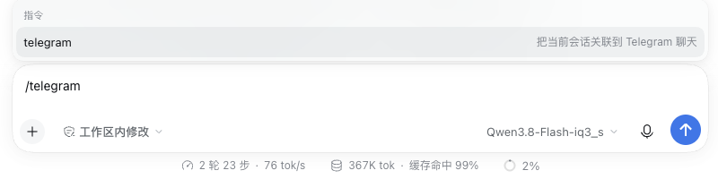
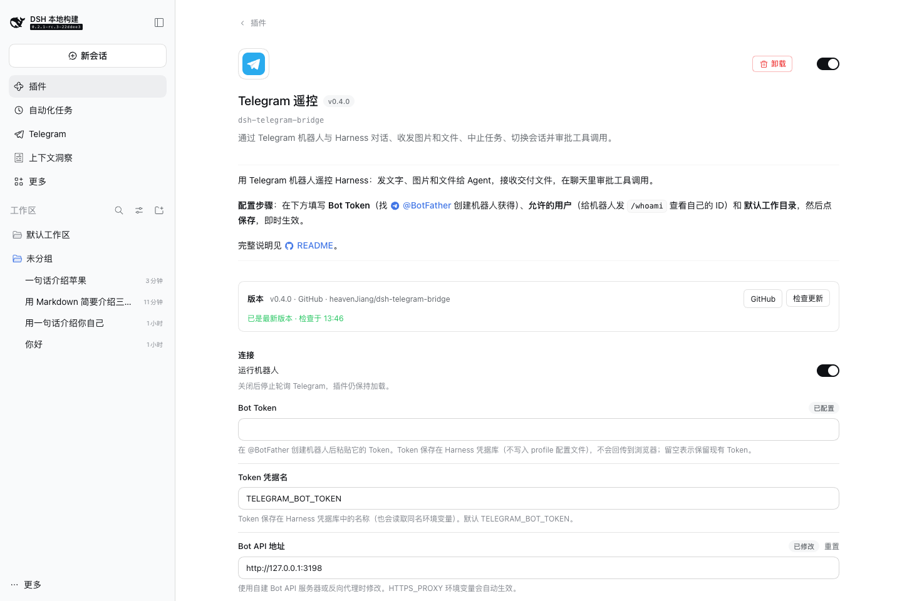

# 掌上指挥台（Switchboard · dsh-switchboard）

[English](README.md) | 中文


在手机上通过 Telegram 机器人指挥 DeepSeek Harness 的 Agent：在手机上给 Agent 发文字、图片、文件和语音，看它边写边回复，审批工具调用、回答它的提问，订阅长任务的完成通知；在 Web 端查看所有聊天记录，并把任意会话关联到 Telegram。

机器人是 Web Host 的另一个客户端：它通过 `ctx.sessionController`（与 Web 界面同一条路径）创建会话和发送消息，所以 Telegram 里开的会话会出现在 Web 侧栏中，Web 端的会话也可以接管或订阅。机器人新建的会话会放进工作目录对应的 Web 工作区（没有就自动创建），和其他会话一起显示在侧栏里。


## 快速开始

1. 在 Telegram 找 [@BotFather](https://t.me/BotFather)，发送 `/newbot` 创建机器人，复制 Token。
2. 安装到 Web profile：在 Web 侧栏 **插件 → 添加插件** 中填 `github:heavenJiang/dsh-switchboard`，或用命令行：

   ```sh
   dsh plugin --profile web add github:heavenJiang/dsh-switchboard
   ```

3. 打开侧栏 **插件 → 已安装插件 → 掌上指挥台**（也可以点侧栏 **掌上指挥台** 右上角的 **插件设置**），填写 **Bot Token**、**允许的用户**（先给机器人发 `/whoami` 查看自己的 ID）和 **默认工作目录**，点 **保存**，即时生效。

## 在 Telegram 里

| 命令 | 作用 |
| --- | --- |
| 直接发文字 / 图片 / 文件 / 语音 | 交给当前会话；没有会话时自动在默认工作目录新建 |
| `/new [目录]` | 新建会话 |
| `/cwd <目录>` | 设置本聊天新会话的工作目录 |
| `/sessions` | 最近的会话（带序号） |
| `/use <序号\|会话ID>` | 切换到已有会话（含 Web 端会话） |
| `/watch [序号\|会话ID]` | 订阅某个会话的完成与审批通知；不带参数列出订阅 |
| `/unwatch <序号\|会话ID\|all>` | 取消订阅 |
| `/stop` | 中止当前工作 |
| `/steer <文字>` | 在正在进行的轮次中途插话引导 |
| `/queue`、`/cancel <序号\|all>` | 查看、取消排队中的消息 |
| `/model [模型名]` | 查看或切换当前会话的模型（按钮列表，支持模糊匹配；不影响 Web 默认） |
| `/mode [模式]` | 查看或切换当前会话的权限模式（只读 / 工作区可写 / 完全访问） |
| `/get <路径>` | 获取工作目录里的文件，或列出目录（不能越出工作目录，符号链接也不行） |
| `/status` | 当前会话、模型、工作目录与运行状态 |
| `/whoami` | 显示你的用户 ID 与聊天 ID（任何人可用） |
| Harness 命令 | `/compact`、`/plan`、`/goal`、`/permission`、`/export` 等，与 Web 输入框一样在宿主上直接执行，结果发回聊天；`/help` 和命令菜单会列出当前可用的命令 |
| 其他 `/xxx` | 不是命令的，原样作为文字交给 Agent |

**回复的呈现**

- Agent 的 Markdown 回复会转换成 Telegram 支持的格式：粗体、斜体、行内代码、带语言的代码块、链接、标题、引用、列表。表格转成等宽块，长回复按段落和代码块安全分段。如果 Telegram 拒绝了排版，自动退回纯文本。
- **边写边显示**：回复生成时先发一条草稿，每隔一两秒更新，写完后原地替换成排版好的正式回复。
- **工具调用**：两次回复之间的所有工具调用合并成一条「🛠 工具调用 · N 次」消息，就地更新（编辑消息不会触发通知），不会刷屏。
- **回合摘要**：长任务结束时发一行摘要，包括用时、工具调用次数、改动了哪些文件。默认只在超过 60 秒的任务后发送，可以设置为每轮都发或关闭。
- 运行期间显示「正在输入」。出错或中止会说明原因。

**审批与提问**

- **工具审批**：需要审批时，聊天里弹出带参数预览的 **允许一次 / 拒绝** 按钮。
- **Agent 提问**：Agent 调用「向用户提问」工具时，问题和选项按钮会发到聊天里，多选题勾选后点 **完成**。问题待回答期间，直接发文字就是自定义回答，不会被当成新消息。
- 两者都只有允许的用户能操作，超时未答（默认 300 秒）交回 Web 界面。

**图片、文件与语音**

- **图片和文件**：照片、文件、视频、音频、静态贴纸都会通过 `ctx.fileUploads` 暂存进会话，这是 Web 输入框添加附件的同一条路径。图片按文件头字节识别真实类型，走图片通道，模型能直接看图；其他类型作为文件交给 Agent。图片说明作为文字，相册合并成一条消息。
- **语音**：先用 ffmpeg 转成 WAV，再用 Harness 的语音识别（语音输入插件）转成文字发给 Agent，聊天里会显示识别结果。识别不可用时（例如模型还没准备好），语音作为文件交给 Agent，并说明原因。
- **交付文件**：Agent 用 `present` 工具交付的文件会发回聊天，常见图片直接显示，其他作为文件发送。
- 官方 Bot API 最多只能下载 20 MB 的文件；要接收更大的文件，需要自建 [Bot API 服务器](https://github.com/tdlib/telegram-bot-api) 并修改 **Bot API 地址**。

**群聊**

- 默认只响应命令、@机器人 和回复机器人的消息，群里的其他闲聊会被忽略。
- 可以按用户授权，也可以在 **允许的聊天** 里填群组 ID，授权整个群的成员。
- 聊天记录面板里，群聊可以按成员筛选。

**安全**

- 只有 **允许的用户**（以及 **允许的聊天** 里的成员）能使用机器人，列表为空时拒绝所有人。
- 陌生人每小时最多收到一次「未授权」提示，不会被利用来刷屏。
- Token 保存在 Harness 凭据库（`TELEGRAM_BOT_TOKEN`，也会读取同名环境变量），不写入 profile 配置文件，也永远不会回传到浏览器。旧版本写在配置文件里的明文 Token，在设置页重新保存一次就会迁移进凭据库，并从配置文件中删除。
- 默认权限预设是 `workspace-write`，并在 Telegram 中审批。除非清楚后果，不要使用 `danger-full-access`。

## 在 Web 里

**掌上指挥台面板**（侧栏入口）

- **左栏**：所有聊天，可搜索，显示机器人连接状态；只被拦截过的陌生人带「未授权」标签。
- **右栏**：没选中聊天时显示概览，包括今日消息、7 天活跃聊天、审批和拦截次数，以及近 14 天的消息量图表。选中聊天后显示完整记录：气泡区分用户和机器人，图片直接显示，文件显示为卡片，工具调用和审批用紧凑样式，群聊可按成员筛选；**打开会话** 一键跳到绑定的会话。
- 右上角有 **插件设置** 按钮，发现新版本时旁边会出现 **新版本** 徽章。


**会话内的掌上指挥台标签页**

每个会话里都有 **掌上指挥台** 标签页：
- 查看关联的聊天，可以解除关联；
- 从已知聊天里选一个 **绑定**（聊天里发的消息交给本会话，回复也发回去）或 **订阅**（只收完成和审批通知）；
- 以机器人身份给绑定的聊天发消息，支持 Markdown；
- 查看本会话的 Telegram 记录。

**Web 输入框里的 `/telegram` 命令**



- `/telegram`：列出当前会话关联的聊天和所有可用聊天。
- `/telegram bind <聊天>`、`/telegram watch <聊天>`、`/telegram unbind [聊天]`、`/telegram send <文字>`：分别是绑定、订阅、解除关联、发消息。`<聊天>` 可以是聊天 ID、`@用户名` 或标题的一部分。

命令在宿主上直接执行，不会进入模型上下文。

**提示词注入**

绑定了聊天的会话会注入一段简短说明，告诉模型：回复会在手机上的 Telegram 里阅读，要简洁，长内容用文件交付。可以在设置里关闭或改写。这段说明用 `ctx.systemPrompt.context()` 注入，只作用于绑定的会话，对 KV 缓存友好。

## 模型

一个会话用哪个模型，按优先级从高到低决定：

1. 在 Telegram 里用 `/model` 为这个会话选的模型；
2. 插件页「机器人默认模型」，作用于机器人新建的会话，可以附带推理强度；
3. Web 默认模型。

前两种方式都直接记在会话自身，**不会改变 Web 的默认模型**。`/model` 和 `/mode` 对当前不在内存中的会话做的选择会持久保存，在会话下次加载时（处理消息之前）生效。

## 定时任务推送

在 **定时任务推送聊天** 里填聊天 ID 后，Harness 定时任务（自动化任务）运行时，Agent 的回复和回合摘要会发到这些聊天。

## 版本与更新

插件详情页（配置表单上方）有 **版本** 区块：显示当前版本和安装来源，可以 **检查更新**。

- **从 GitHub 安装**：检查默认分支最新提交里 `package.json` 的版本号。点 **更新到 vX.Y.Z** 后，插件管理器用最新提交就地重装。新提交第一次安装需要授权构建脚本，页面会列出要授权的条目，确认后继续。
- **从 npm 安装**：调用插件管理器原生的更新接口。
- **本地链接或来源不明**：只显示版本，不检查也不更新，避免误装 npm 上同名的其他包。

> 发布新版本：修改代码后**提升 `package.json` 的 `version`** 再推送。

## 配置项

所有字段都可以在插件页修改，并即时生效；`pollTimeoutSec`、`stateFile` 除外，需要写在 profile 的 `cordis.patch.yml` 中。设置页按下面的分组排列：

| 分组 | 字段 | 默认值 | 说明 |
| --- | --- | --- | --- |
| 连接 | `enabled` | `true` | 是否运行机器人 |
| | `botTokenRef` | `TELEGRAM_BOT_TOKEN` | Token 在凭据库中的名称（也读取同名环境变量） |
| | `botToken` | — | 旧版明文 Token（兼容用，设置页保存后会迁移进凭据库） |
| | `apiBaseUrl` | `https://api.telegram.org` | Bot API 地址（自建服务器或反代） |
| | `language` | `zh` | 机器人提示语言（`zh` / `en`） |
| 访问控制 | `allowedUsers` | `[]` | 允许的用户 ID 或 `@用户名` |
| | `allowedChats` | `[]` | 允许的聊天 ID（其中所有成员可用） |
| | `groupMentionOnly` | `true` | 群聊中只响应命令、@机器人、回复机器人 |
| 会话 | `workspacePath` | `''` | 新会话默认工作目录 |
| | `modelProvider` / `model` / `reasoningEffort` | 空 | 机器人新建会话的模型；为空跟随 Web 默认 |
| | `agentPreset` | `standard` | 新会话的 Agent 预设 |
| | `permissionPreset` | `workspace-write` | 新会话的权限预设 |
| | `channelPrompt` / `channelPromptText` | `true` / 空 | 是否注入 Telegram 场景说明 / 自定义说明 |
| 消息与通知 | `streamReplies` | `true` | 边写边显示回复 |
| | `notifyToolCalls` | `true` | 显示工具活动消息 |
| | `turnSummary` / `turnSummaryMinSec` | `long` / `60` | 回合摘要：`off` / `long` / `always`，及长任务阈值 |
| | `scheduleChats` | `[]` | 定时任务结果推送的聊天 ID |
| 审批 | `approvalViaTelegram` | `true` | 在 Telegram 中审批 |
| | `questionsViaTelegram` | `true` | 在 Telegram 中回答 Agent 的提问 |
| | `approvalTimeoutSec` | `300` | 审批与提问的超时（10–3600 秒） |
| 文件与语音 | `sendDeliverables` | `true` | 把 `present` 交付的文件发回聊天 |
| | `maxDownloadMb` | `20` | 接收文件大小上限（1–2000 MB） |
| | `transcribeVoice` / `ffmpegPath` | `true` / `ffmpeg` | 语音转文字 / ffmpeg 路径 |
| 界面与记录 | `showPanel` / `showSessionTab` | `true` | 侧栏掌上指挥台入口 / 会话内标签页 |
| | `historyLimit` | `2000` | 每个聊天保留的记录条数 |
| （文件） | `pollTimeoutSec` | `30` | 长轮询等待秒数 |
| （文件） | `stateFile` | `$DSH_HOME/switchboard/state.json` | 绑定、订阅、待生效选择与轮询进度 |

网络受限时，在启动 `dsh` 前设置 `HTTPS_PROXY` 即可，Harness 的出站代理策略会自动覆盖机器人的请求。



## 架构

```
src/index.ts       宿主入口：配置 schema、接入 sessionController / agents / approval / user-questions / 可选服务
src/bridge.ts      桥接核心：长轮询、命令、渲染与流式输出、工具活动、摘要与订阅、审批与提问（经 HarnessPort 解耦，可单测）
src/markdown.ts    Markdown → Telegram HTML 与安全分段
src/telegram.ts    精简 Bot API 客户端（Node fetch，429 退避、文件下载、multipart 上传）
src/media.ts       附件提取、图片类型识别、回传方式选择
src/bindings.ts    绑定、订阅、待生效选择、update offset 的持久化
src/chatlog.ts     Web 查看器的聊天记录（JSONL + 索引 + 图片副本 + 每日统计）
src/routes.ts      owner-only 路由（ctx.connection.fetch）
src/command.ts     Web 输入框的 /telegram 命令（ctx.commands）
src/updates.ts     版本检查（GitHub / npm，经宿主代理）
src/version.ts     安装来源解析与版本比较（宿主与浏览器共用）
src/client/        浏览器半侧：掌上指挥台面板、会话标签页、设置页（分组）、版本区块
cordis.patch.yml   组合包层：插入 id 为 switchboard 的插件行
```

用到的扩展点：
- **事件**：`session/event`、`agent/assistant-stream`、`agent/status`、`agent/created`；
- **waterfall**：`approval/request`、`user-questions/request`，都以 prepend 方式先于 Web 应答，超时调用 `next()` 交回；
- **可选服务**：`ctx.systemPrompt.context`、`ctx.commands`、`ctx.credentials`、`ctx.speechToText`、`ctx.workspaceChanges`、`ctx.connection`，存在时才接入。
- **浏览器端 slot**：`sidebar.panellist`、`main`、`conversation.view`、`plugins.bundle.config`。

## 开发

需要相邻目录有已构建的 deepseek-harness 检出（`../deepseek-harness`），用于类型检查和加载器组合测试。

```sh
pnpm install
pnpm typecheck   # 宿主 + 浏览器两侧
pnpm test        # vitest：假 Bot API + 假 Harness；有相邻检出时还会跑真实 Loader 组合测试
pnpm build       # esbuild → lib/index.js 与 lib/client.js（客户端模块系统的 factory 格式）
```

`pnpm build` 同时是 `prepare` 脚本，所以可以直接从 Git 安装。发布到 npm 的准备事项见 [docs/PUBLISHING.md](docs/PUBLISHING.md)，版本变化见 [CHANGELOG.md](CHANGELOG.md)。
